# 🏠 RentNest — Production-Ready Rental Home Platform
## Master Product Requirements & Industry Standard Feature Specification (All-in-One Document)

---

## 1. Executive Summary & Platform Concept

**RentNest** is a modern, transparent, and high-trust rental property marketplace built specifically for high-growth urban rental markets (starting with **Rajkot, Gujarat**). 

The platform bridges the gap between **Tenants (Home Seekers & Flatmate Hunters)**, **Property Owners (Direct Landlords)**, and **Verified Brokers/Agents**. It solves the biggest pain points in the rental industry:
1. **Misleading Listings & Fake Photos**: Eliminating "ghost" listings and bait-and-switch broker ads.
2. **Hidden Living Costs**: Bringing complete upfront transparency to electricity sub-meters, maintenance fees, and water tanker charges.
3. **Wasted Physical Visits**: Providing complete house rules (curfew, visitor policies, pure-vegetarian preferences) before scheduling a visit.
4. **Deposit Disputes**: Offering move-in condition checklists and clear exit terms.
5. **Slow Communication**: Integrating instant WhatsApp connectivity alongside in-app chat and automated visit scheduling.

---

## 2. Platform Architecture: Web-First Strategy & Mobile Roadmap

RentNest will launch as a **Web Application first**, followed by a dedicated mobile app in Phase 2. The reasons for prioritizing a responsive web application are based on real-world PropTech user behavior:

### 2.1 Web vs. Native Mobile App Comparison

| Factor | Web Application (Responsive / PWA) | Native Android Mobile App |
| :--- | :--- | :--- |
| **Discovery & Google SEO** | ⭐️⭐️⭐️⭐️⭐️ **Massive Advantage**. 80%+ of tenants begin with a Google search (*"2 BHK flat for rent Kalawad road Rajkot"*). Each locality and listing gets its own indexable web page. | ⭐️⭐️ App stores have zero web SEO for individual property listings. |
| **User Drop-off & Friction** | ⭐️⭐️⭐️⭐️⭐️ **Near Zero**. Shared links on WhatsApp or Instagram open instantly in 1 second without requiring an app download. | ⭐️⭐️ High friction. Asking users to install a 50MB APK just to view a single house causes 65%+ bounce rates. |
| **Physical "To-Let" QR Scanning** | ⭐️⭐️⭐️⭐️⭐️ Instant. Anyone passing a house on the street scans a QR code and views photos directly in their mobile browser. | ⭐️⭐️ Forces user to download an app before showing details. |
| **Desktop / Tablet Browsing** | ⭐️⭐️⭐️⭐️⭐️ Rich split-screen map & listing comparison view for working professionals and families. | ⭐️ Phone screen only. |
| **Development Speed & Cost** | ⭐️⭐️⭐️⭐️ Instant code updates, zero app store review delays. | ⭐️⭐️ App store review delays and multi-platform maintenance. |
| **Real-time Notifications** | ⭐️⭐️⭐️ Supported via Web Push & WhatsApp API. | ⭐️⭐️⭐️⭐️⭐️ Native device push notifications. |

### 2.2 The Web-First Implementation Strategy:
1. **Phase 1 (Web Application First)**:
   * Build a **Mobile-First Responsive Web Application** with **PWA (Progressive Web App)** support.
   * Mobile browser users can tap *"Add to Home Screen"* for an app-like icon and full-screen experience without Play Store friction.
   * Full Google SEO indexation with dynamic meta tags and OpenGraph cards for rich WhatsApp link previews (photo, price, BHK, locality).
2. **Phase 2 (Mobile App Rollout)**:
   * Deploy native Android APK / Google Play Store release (using Flutter or React Native / Capacitor wrapper sharing the same backend API) once initial listing volume and active user base are established.

---

## 3. User Roles, Personas & Permissions

The platform supports **four distinct user roles**:

### 3.1 Tenant (Home Seeker & Flatmate Hunter)
* Searches, filters, and compares rental homes.
* Can search for whole flats/houses or individual rooms / flatmate vacancies.
* Saves searches, favorites listings, and receives instant WhatsApp/Email alerts.
* Directly contacts owners via WhatsApp or in-app chat.
* Schedules in-person property visits with automated reminders.
* Accesses free utilities (HRA Rent Receipt Generator, Move-in Photo Checklist).

### 3.2 Property Owner (Direct Landlord)
* Posts properties using an intuitive step-by-step wizard.
* Specifies total pricing, electricity meter type, water schedule, and house rules.
* Controls contact privacy: *"Show phone to all"*, *"Verified tenants only"*, or *"Chat/WhatsApp only"*.
* Can verify ownership via electricity bill / property tax document to earn the **"Verified Owner"** badge.
* Downloads an auto-generated printable **"TO LET" QR Code Poster** to paste on their building gate.
* Receives automated 21-day WhatsApp check-ins to keep listing status fresh or mark as rented in 1 click.

### 3.3 Real Estate Broker / Agent
* Dedicated Agent profile clearly tagged with a **"Broker / Agent"** badge (preventing misleading "direct owner" claims).
* Explicitly states brokerage terms upfront (e.g. *15 Days Rent* or *1 Month Rent*).
* Manages multiple client properties from a unified broker inventory dashboard.

### 3.4 Platform Admin & Operations Team
* Reviews and approves owner verification requests (KYC / electricity bill cross-checks).
* Moderates flagged listings (reports on scam pricing, fake photos, already rented properties).
* Automated duplicate and fake broker detection engine.
* Monitors market trends, active listings, and user analytics.

---

## 4. Comprehensive Property Search & Discovery Experience

### 4.1 Search Bar & Geographic Discovery
* **Locality Multi-Select**: Support for all key Rajkot zones and neighborhoods:
  * *Kalawad Road, 150 Ft Ring Road, University Road, Raiya Road, Mavdi, Nana Mava, Amin Marg, Sadhu Vaswani Road, Gondal Road, Bhakti Nagar, Kotecha Chowk, Race Course, Madhapar, Metoda GIDC, etc.*
* **Landmark & Landmark Radius Slider**: Search within 1 km, 2 km, 5 km, or 10 km of major landmarks (e.g., *AIIMS Rajkot, Saurashtra University, RK University, Crystal Mall, Bus Station*).
* **Commute & Travel Time Filter**:
  * *"Show homes within 15–20 minutes travel time of my office / university"*.
  * Filter by proximity to BRTS / RMTS city bus corridors.

### 4.2 Interactive Map & Split-Screen View (Desktop Web UX)
* **Desktop / Laptop View**: Zillow/Airbnb-style split-screen:
  * Left side: Interactive map with clickable price pins (e.g., `₹12k`, `₹18k`).
  * Right side: Scrollable grid of property cards with high-res photos and key tags.
  * Hovering over any card instantly highlights the corresponding pin on the map.
* **Mobile Web View**: Clean toggle between "List View" and "Map View".

### 4.3 Exhaustive Real-World Filter Engine

#### A. Pricing & Total Monthly Outflow
* **Rent Range Slider**: Min and Max monthly rent (e.g., ₹4,000 to ₹75,000+).
* **Security Deposit**: 1 Month / 2 Months / 3+ Months deposit.
* **No Brokerage Toggle**: Instant filter for **"Owners Only (Zero Brokerage)"**.
* **Maintenance Filter**: "Maintenance Included in Rent" vs "Extra".
* **Electricity Meter Transparency**:
  * *Direct PGVCL Govt Meter* (pay official bill rate) vs *Sub-Meter* (fixed rate per unit).

#### B. Property Type & Space
* **Property Category**: Apartment / Flat, Independent House / Bungalow, Row House / Tenement, Penthouse, PG / Co-living, Single Room in Shared Flat.
* **BHK Configuration**: 1 RK, 1 BHK, 2 BHK, 3 BHK, 4+ BHK.
* **Floor Preference**: Ground Floor, Lower Floors (1–3), Higher Floors (4+), Penthouse / Top Floor.
* **Facing & Vastu**: East, North-East, North facing.

#### C. Water Supply Reality (Top Tenant Priority)
* **Water Availability**: 24/7 continuous water supply OR Scheduled municipal water (e.g., 1–2 hours daily).
* **Water Source**: Municipal Corporation (RMC/Narmada pipeline), Borewell, or Tanker dependent.
* **Drinking Water**: Dedicated RO point / Installed RO water purifier.

#### D. House Rules & Living Culture
* **Tenant Category**: Family Only, Bachelors (Male), Bachelors (Female), Working Professionals Only, Any.
* **Food & Dietary Rules**: Pure Vegetarian Only (essential for Jain/Vaishnav/Gujarati communities) vs Non-Veg Allowed.
* **Gate Curfew / Night Access**: 24/7 open entry / self-key access OR Society gate locked at 10:30 PM.
* **Visitor / Guest Policy**: Overnight guests permitted / restricted.
* **Pets Policy**: Pets Allowed / Not Allowed.

#### E. Key Amenities Checklist
* Dedicated Covered 4-Wheeler Car Parking / 2-Wheeler Parking.
* Lift / Elevator with power backup.
* Piped Natural Gas (PNG) connection (Gujarat Gas / Adani Gas).
* High-Speed Fiber Internet readiness (JioFiber / Airtel Xstream).
* Gated Society with 24/7 Security Guard & CCTV surveillance.
* Balcony / Utility Area & Private Terrace.
* Power Backup (Inverter installed / Society generator).

#### F. Move-In Availability & Furnishing
* **Availability**: Ready to move immediately / Available from specific date / Within 15–30 days.
* **Furnishing Level**: Fully Furnished, Semi-Furnished, Unfurnished.

#### G. Sorting Options
* Price: Low to High / High to Low.
* Newest Listings First.
* Verified Properties First.
* Most Popular / Most Viewed.

### 4.4 Saved Searches & Instant Smart Alerts
* Tenants can click **"Save This Search & Alert Me"** (e.g., *2 BHK in Kalawad Road under ₹14,000*).
* Whenever an owner lists a matching property, the tenant receives:
  * Instant **WhatsApp alert** with direct link.
  * Browser Web Push Notification (if enabled).
  * Email alert.

### 4.5 Roommate & Flatmate Sharing Section
* A dedicated tab for students and young working individuals seeking roommates:
  * *"Need 1 Female Roommate for Master Bedroom in 2 BHK flat on University Road — ₹4,500/month"*.
  * Tagged by: Profession (Student/Doctor/IT), Diet preference, Move-in date.

---

## 5. Property Details Page (The Transparency Hub)

Every property page is structured to answer all tenant questions before they ever pick up the phone:

### 5.1 Media & Visual Tour
* High-resolution multi-photo carousel with full-screen zoom.
* Room-tagged photos (*Living Room, Master Bedroom, Kitchen, Balcony, Bathroom, Exterior/Entrance*).
* Watermarked images (*"RentNest Verified"*) preventing unauthorized broker scraping and re-posting.
* Embedded YouTube / Vimeo video walkthrough tour.

### 5.2 Complete Living Cost Breakdown
A dedicated financial table displaying:
* **Monthly Rent**: ₹15,000 / month
* **Security Deposit**: ₹30,000 (2 months — refundable)
* **Monthly Maintenance**: ₹1,200 / month (or marked *Included in Rent*)
* **Electricity**: Direct PGVCL meter (pay actual bill) OR Sub-meter at ₹10/unit
* **Water**: Included in maintenance (Municipal supply 2 hours morning + Borewell 24/7)
* **Brokerage**: ₹0 (Direct Owner) OR Clearly stated broker fee
* **Estimated Total First Month Outflow**: Rent + Deposit + Maintenance calculated automatically.

### 5.3 Daily Living Factsheet
* **Water Details**: Source, timing, storage tanks capacity.
* **Parking Details**: Allotted covered car parking number, visitor parking availability.
* **Floor & Sunlight**: Floor number, total floors, East-facing balcony with open view.
* **Broadband Ready**: JioFiber / Airtel fiber pre-wired in building.

### 5.4 House Rules & Freedom Badges
* Clear visual badges:
  * 🥦 *Pure Vegetarian Only*
  * 🔑 *24/7 Gate Access (No Curfew)*
  * 👥 *Family Preferred / Bachelors Welcomed*
  * 🐾 *No Pets Allowed*

### 5.5 Deposit, Lease & Exit Terms
* Minimum lock-in period (e.g., 6 months minimum stay).
* Notice period (e.g., 30 days written notice before vacating).
* Deposit refund conditions clearly stated.

### 5.6 Neighborhood & Commute Insights
* Distance to nearby daily essentials:
  * Grocery / Supermarket (e.g., *D-Mart — 800m*)
  * Hospitals (e.g., *AIIMS / Civil Hospital — 2.5km*)
  * Schools & Colleges (e.g., *Saurashtra University — 1.2km*)
  * Public Transport (e.g., *BRTS Stop — 400m*)

### 5.7 Direct Owner & Broker Contact Actions
* **Primary Action**: **"Chat on WhatsApp"** button.
  * Launches WhatsApp with a pre-formatted message:
    > *"Hi! I saw your 2 BHK flat on RentNest (Listing #RN-204) at Kalawad Road. Is it available for a visit?"*
* **Secondary Action**: **"Call Owner"** (Reveals phone number according to owner's privacy settings).
* **Tertiary Action**: **"Schedule Visit"** (Opens calendar slot picker).
* **Safety Banner**: *"RentNest Warning: Never pay any token or booking advance before visiting the property in person and verifying property documents."*

### 5.8 Multi-Property Shortlist & Compare Tool
* Tenants can shortlist up to **3 properties** and view an interactive side-by-side comparison table (comparing Rent, Total Deposit, Maintenance, Sq Ft, Water Timings, Parking, and Amenities).

---

## 6. Property Listing Wizard (Owner & Broker Experience)

Listing a property should take less than 4 minutes, while capturing all critical details:

### 6.1 Step-by-Step Listing Wizard
1. **Basic Info**: Property Type (Flat, House, PG, Shared Room), BHK, Society Name, Locality dropdown + GPS map pin.
2. **Pricing & Costs**: Monthly Rent, Security Deposit, Maintenance (Included/Extra), Electricity Meter type, Brokerage terms (0 for owners).
3. **Property Dimensions & Furnishing**: Carpet Area (sq. ft.), Floor number, Total floors, Balconies, Furnishing level with itemized inventory checklist (AC, Fridge, Washing Machine, Sofa, Bed, Wardrobe).
4. **Water & Utilities**: Water supply schedule, source (Municipal/Borewell), Piped Gas, Internet readiness.
5. **Rules & Preferences**: Tenant type (Family/Bachelors), Food preference (Pure Veg/Any), Curfew timing, Pet policy.
6. **High-Resolution Photos**: Multi-photo upload with drag-and-drop cover photo selection and room tag assignments.
7. **Contact Privacy Preferences**:
   * *Option A*: Direct Call + WhatsApp (Fastest response).
   * *Option B*: Contact via WhatsApp Only.
   * *Option C*: Verified Tenants Only (Tenants must have completed profile/ID to see contact).

### 6.2 Printable "TO LET" Signboard with QR Code Generator
* Once the listing is published, the owner can click **"Download TO LET Poster"**.
* Generates a clean, ready-to-print A4 PDF poster featuring:
  * Bold **"TO LET / FOR RENT"** headline.
  * Property Highlights (e.g., *2 BHK Fully Furnished, Kalawad Road*).
  * A large **QR Code**.
  * Anyone passing by on the street scans the QR code with their mobile camera and immediately views photos, rent, and contact details online—saving the landlord from repeated phone interruptions.

### 6.3 Listing Freshness & Inventory Management
* **1-Click "Mark as Rented"**: Instantly removes property from search results when leased, terminating unwanted inquiries.
* **Automated WhatsApp Freshness Bot**:
  * Every 21 days, the system sends an automated WhatsApp message to the owner:
    > *"RentNest Check: Is your 2 BHK flat at Kalawad Road still available? Reply 1 for YES, 2 for ALREADY RENTED."*
  * If the owner replies 2 or fails to respond after 2 reminders, the listing is automatically unlisted to prevent dead/ghost inventory.

---

## 7. Communication & Visit Scheduling Engine

### 7.1 Direct WhatsApp Lead Generation
* Direct WhatsApp integration is the primary communication channel in Indian Tier-2 markets.
* Automated message templates contain listing ID, property title, and tenant visit interest.

### 7.2 In-App Real-Time Chat (Alternative to Phone Sharing)
* In-app messaging for users who prefer keeping their personal phone numbers private.
* Built on WebSockets / Supabase Realtime.
* Features:
  * Read receipts and typing indicators.
  * Pre-set quick reply chips (*"Is rent negotiable?", "Can I visit Saturday morning?", "Is car parking covered?"*).
  * Built-in anti-fraud alerts warning against upfront token payments.

### 7.3 Calendar-Based Visit Scheduling
1. **Tenant Request**:
   * Tenant picks preferred date and time slot (*Morning: 10 AM–12 PM, Afternoon: 2 PM–4 PM, Evening: 5 PM–7 PM*).
   * Adds an optional note (*"Visiting with my parents"*).
2. **Owner Action**:
   * Owner gets instant notification with 3 choices: **Accept**, **Propose Another Time**, or **Decline**.
3. **Confirmed Visit Pass**:
   * Generates a digital visit pass with Google Maps route directions and owner contact.
   * Automated reminder sent 2 hours before the scheduled slot.
4. **Post-Visit Feedback**:
   * Tenant is asked: *"Did you visit? Was the property as described in the photos?"* (Helps identify fake photos or misrepresentations).

---

## 8. Trust, Safety & Anti-Scam Verification Systems

### 8.1 "RentNest Verified" Property Badge
* Owners can upload a copy of their latest **PGVCL Electricity Bill** or **RMC Municipal Property Tax Receipt**.
* Admin/Operations verifies the owner's name and property address against the document.
* Verified properties receive a prominent green **"Verified Owner"** badge and rank higher in search results.

### 8.2 Anti-Broker Impersonation Guard
* In local markets, brokers often pretend to be direct owners to avoid "No Brokerage" filters.
* Platform rule: If a single phone number or account posts more than **2 distinct properties** across different societies without a registered Agent profile, the system flags the account and requires them to switch to a Broker profile.

### 8.3 Digital Move-In Photo Condition Checklist (Deposit Dispute Shield)
* When a tenant moves in, both tenant and landlord can upload timestamped photos of the home's condition (walls, tiles, bathroom fittings, electrical points, AC working condition).
* Stored securely in the platform's database.
* Upon move-out, this checklist acts as unbiased proof, eliminating unfair security deposit deductions.

### 8.4 User Flagging & Scam Prevention
* Prominent **"Report Listing"** button on every property with categorized options:
  * *Broker posing as direct owner*
  * *Property already rented / unavailable*
  * *Owner demanding advance payment/token before visit*
  * *Incorrect pricing or hidden extra fees*
  * *Misleading / fake photos*
* Listings receiving multiple valid reports are automatically quarantined for admin review.

---

## 9. Value-Added Growth & Legal Utilities (SEO & Viral Drivers)

These tools bring thousands of organic visitors to the website from Google searches and provide real utility:

### 9.1 Free 1-Click HRA Rent Receipt Generator
* **The Problem**: Salaried corporate and government employees need monthly rent receipts with the landlord's PAN to claim income tax HRA deductions.
* **The Solution**: A 100% free web tool on RentNest:
  * Tenant enters: Tenant Name, Landlord Name, Landlord PAN (optional if rent < ₹1L/yr), Monthly Rent, and Rental Period.
  * Generates an instant, professionally formatted, ready-to-print PDF rent receipt.
* **SEO Impact**: Ranks high on Google for *"HRA rent receipt generator online"*, bringing thousands of tenants to your platform without spending money on ads.

### 9.2 Gujarat Standard 11-Month Rental Agreement Generator
* Pre-formatted standard 11-month bilingual (English & Gujarati) rental agreement draft.
* Auto-populates tenant details, owner details, property address, monthly rent, security deposit, maintenance terms, and 30-day notice period.
* Exportable as an editable Word document or printable PDF ready for stamp paper execution.

---

## 10. Platform Administration & Operations Dashboard

The back-office admin dashboard allows administrators to:
1. **Verification Queue**: Review uploaded electricity bills and approve/reject "Verified" badges with 1 click.
2. **Moderation & Flagged Listings**: Review user-reported scam listings, inspect evidence, and ban fraudulent accounts.
3. **Listing Management**: View total active, pending, and rented properties; edit or unpublish listings.
4. **Locality & Price Analytics**: Monitor average rental rates across Rajkot localities (e.g., average 2 BHK rent on Kalawad Road vs. Nana Mava) to provide market pricing guidance to landlords.

---

## 11. Technology Stack Architecture

| Layer | Recommended Choice | Rationale & Advantage |
| :--- | :--- | :--- |
| **Web Frontend** | **React (Vite) + Tailwind CSS** | Ultra-fast initial page load, responsive on mobile browsers, flexible component design system. |
| **Backend & Database** | **Supabase (PostgreSQL)** | Managed PostgreSQL with built-in Authentication (Phone OTP & Email), Row-Level Security (RLS), Realtime database subscriptions, and automated REST APIs. |
| **Media & File Storage** | **Supabase Storage / AWS S3** | Optimized CDN storage for property galleries, KYC electricity bill documents, and generated agreement PDFs. |
| **Maps & Geolocation** | **Leaflet (OpenStreetMap) + Google Maps Embed API** | Cost-effective geolocation, interactive pin placing, and route directions. |
| **Alerts & Communication** | **Twilio / Gupshup / WhatsApp Business Cloud API** | Instant WhatsApp alerts for new matching properties, visit confirmations, and freshness checks. |
| **SEO & Sharing** | **Dynamic OpenGraph Meta Tags** | Ensures when a listing URL is shared on WhatsApp, a rich preview card with photo, rent, and locality appears automatically. |
| **PWA Layer** | **Vite PWA Plugin (Service Workers)** | Enables offline asset caching and the "Add to Home Screen" mobile experience without native app stores. |

---

## 12. Phased Implementation Roadmap

```mermaid
flowchart TD
    subgraph Phase1["Phase 1: Core Web Platform (MVP)"]
        P1["Auth (Phone OTP / Email) & User Roles"]
        P2["Step-by-Step Property Posting Wizard + Multi-Photo Upload"]
        P3["Search Engine with Rajkot Localities, BHK, Budget & Water Filters"]
        P4["Split-Screen Map + Property Cards (Desktop) & Mobile View"]
        P5["Property Details Page with Total Living Cost Calculator"]
        P6["Direct 'Chat on WhatsApp' & 'Call Owner' Action Buttons"]
        P7["Shortlist & Multi-Property Comparison Tool"]
    end

    subgraph Phase2["Phase 2: Growth, Alerts & Community"]
        P8["Saved Searches with Instant WhatsApp Alerts"]
        P9["Roommate & Flatmate Sharing Section"]
        P10["Printable 'TO LET' Poster with QR Code Generator"]
        P11["Free HRA Rent Receipt Generator (SEO Traffic Magnet)"]
        P12["In-App Real-Time Chat & Visit Scheduling Engine"]
        P13["Automated 21-Day WhatsApp Freshness Check Bot"]
    end

    subgraph Phase3["Phase 3: High-Trust, Legal & Mobile Expansion"]
        P14["Owner Verification Badge (KYC & Electricity Bill Review)"]
        P15["Digital Move-In Photo Condition Checklist"]
        P16["Gujarat 11-Month Rental Agreement Generator"]
        P17["Anti-Scam Flagging & Admin Operations Dashboard"]
        P18["Android Play Store App Launch (PWA / Flutter Native Build)"]
    end

    Phase1 --> Phase2 --> Phase3
```

---

*Document finalized for RentNest. All requirements, search parameters, real-world living factors, and web-first architectural specifications are unified in this single master file.*
